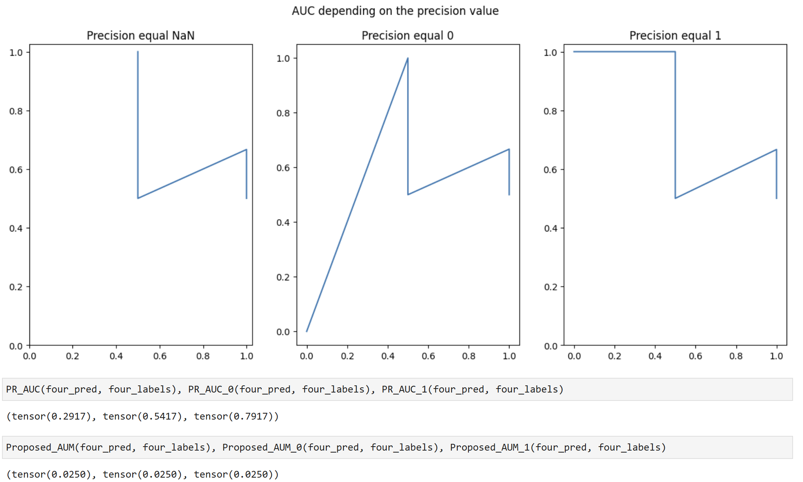
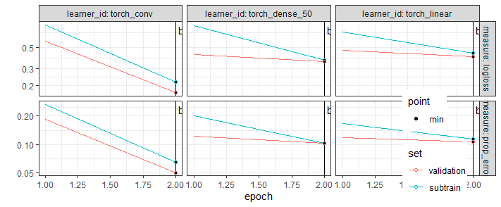
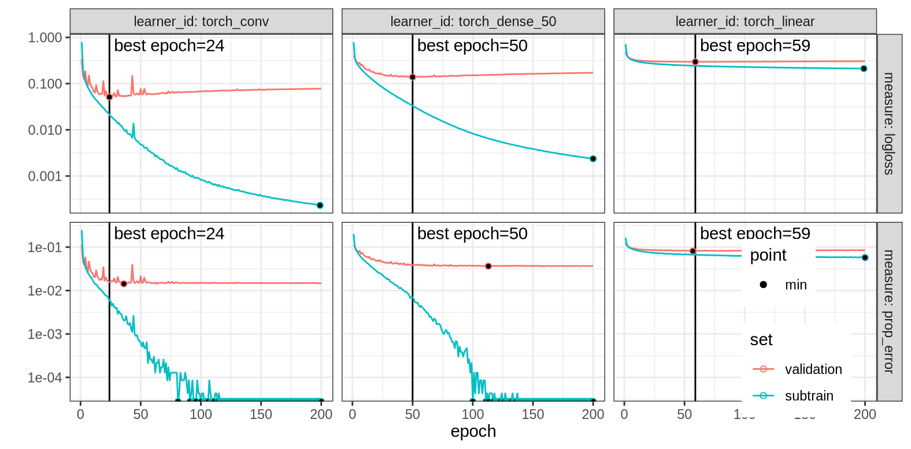
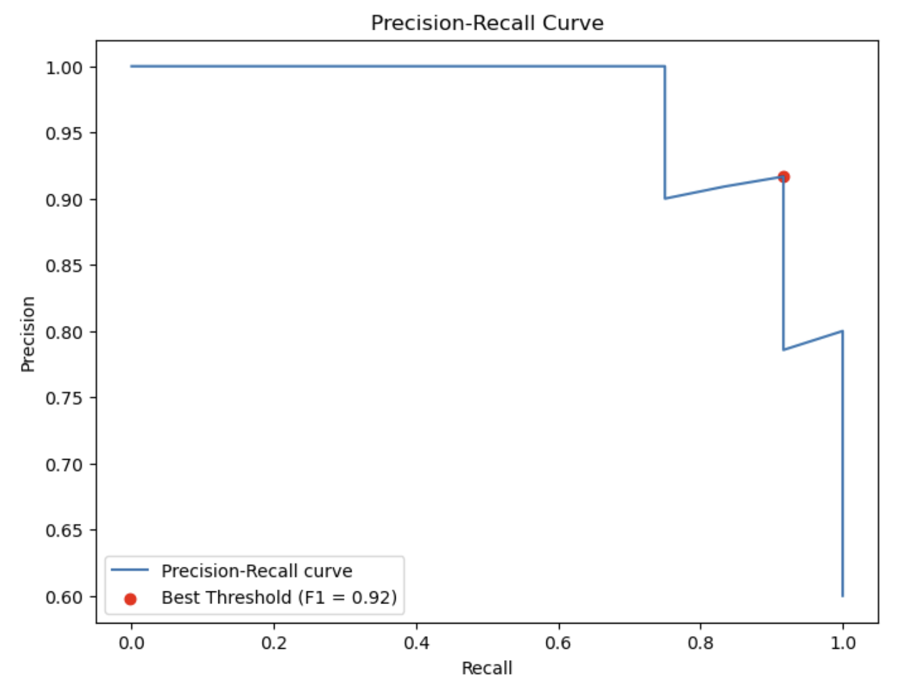
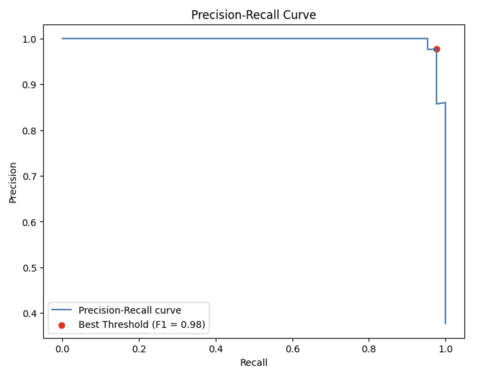

# Introduction
This project is the work I did during my two months summer research internship at the University of Sherbrooke - Department of Computer-Science. I was supervised by [professor Toby Dylan Hocking](https://tdhock.github.io). During my two months I did research on the Precision-Recall AUC and AUM for imbalanced datasets.

---

# Lexicon
ROC : Receiver Operating Characteristic  
PR : Precision-Recall 

AUC : Area Under the Curve  
AUM : Area Under the Minimum  

---

# Data
To get the datasets that I used, you can simply run the file [DownloadData.R](https://github.com/juruch/Internship-Sherbrooke/blob/main/DownloadData.R) in RStudio. Using this file you can download the datasets : 
- MNIST
- EMNIST
- FashionMNIST
  
For the imbalanced datasets you can run [CreateImbalanced.R](https://github.com/juruch/Internship-Sherbrooke/blob/main/PR-AUM/CreateImbalanced.R), you might need to modify the first line depending on where you saved the MNSIT datasets.

---

# Repository organisation
- [Figures](https://github.com/juruch/Internship-Sherbrooke/tree/main/Figures) : my figures for this ReadMe.
- [Learning-PR-Curves](https://github.com/juruch/Internship-Sherbrooke/tree/main/Learning-PR-Curves) : my first codes to understand how to use Precision-Recall curves.
- [ROC-to-PR-Curve](https://github.com/juruch/Internship-Sherbrooke/tree/main/ROC-to-PR-Curve) : translating [ROC codes](https://tdhock.github.io/blog/2024/auto-grad-overhead/) for precision-recall, I later based [my R package](https://github.com/juruch/torchPRcurve) on these codes.
- [PR-AUM](https://github.com/juruch/Internship-Sherbrooke/tree/main/PR-AUM) : my codes and results to experiment the PR-AUM using an [online cluster](https://docs.alliancecan.ca/wiki/Rorqual).

---
# Chronology

## Week 8 - 25/08
This being my last week, my goal is to do as much as possible.
- Finishing my torchPRcurve and try to publishing it to the CRAN.
- Update my codes to use said package.
- Clean my blog posts.

## Week 7 - 18/08
- I wrote two articles for my blog, one on how to install the package torch in RStudio and the other on how to create an R package and how to make pull requests.
- Use a [custom measure](https://github.com/juruch/torchPRcurve/blob/main/R/MeasureClassifPRaum.R) based on my PR_AUM code.

## Week 6 - 11/08
 - [Here](https://github.com/juruch/Internship-Sherbrooke/blob/main/PR-AUM/FirstResults.md) are all the results from the different experiment, with different learners, measures and learning rates.
 - Creation of the file [DownloadData.R](https://github.com/juruch/Internship-Sherbrooke/blob/main/DownloadData.R) for other user to download the datasets I have been working on. It made me learn about the package R `googledrive`.

## Week 5 - 04/08
 - Remaking past figures for more clarity, sometimes changing the number of epochs or the learning-rate.
 - Changing the PR_curve code, now Precision equals one when its denominator is equal to zero to get a more accurate AUC value.

## Week 4 - 28/07
 - I continued my experiments with imbalanced datasets, first using [one VS all](https://github.com/juruch/Internship-Sherbrooke/blob/main/PR-AUM/PR-AUM-oneVSall.R), to see the differences.
 - [Creation of imbalanced dataset](https://github.com/juruch/Internship-Sherbrooke/blob/main/PR-AUM/CreateImbalanced.R) to study the results using my PR_AUM function.
 - I created my R package : [torchPRcurve](https://github.com/juruch/torchPRcurve).
 - During a tutorial I learned about pull-requests and started using them to allow review before merging my new codes.

## Week 3 - 21/07
- After creating the PR AUM function I used it in the code I used at the very begining. [It]([https://github.com/juruch/Internship-Sherbrooke/blob/main/PR-AUM/AUM-PR.R](https://github.com/juruch/Internship-Sherbrooke/blob/main/PR-AUM/PR-AUM.R)) gave me different figures, I then changed the measures to use `classif.prauc` [here](https://github.com/juruch/Internship-Sherbrooke/blob/main/PR-AUM/PR-AUM-prauc.R).
- I also created my own [blog](https://juruch.github.io) to explain things I learned during the internship and write down about my results and my experiences.

## Week 2 - 14/07
- To continue my studies on the PR curve I used [this code](https://tdhock.github.io/blog/2024/auto-grad-overhead/) and transformed it from ROC to PR.  
  I searched how to handle the case where (TP+FP)=0 and how to define the precision in this case.
  I found [this](https://jamesmccaffrey.wordpress.com/2023/02/02/what-are-correct-values-for-precision-and-recall-when-the-denominators-are-zero/) blog post and [this](https://stats.stackexchange.com/questions/8025/what-are-correct-values-for-precision-and-recall-when-the-denominators-equal-0) forum post. I learned that if the prediction's denominator is equal to zero then it means that the model always predicts class negative, similarly for the recall if its denominator is equal to zero then the data only has elements in the negative class.  
  The solution to these issues would be to return an error and set the value of the precision or the recall to NaN and not 0 to differentiate from when the models doesn't predict correctly any positive (no TP).   
    [Here](ROC-to-PR-Curve/PR.md) I looked at the differences between the two codes. I then redid the same thing [here](ROC-to-PR-Curve/PR.ipynb) using python and also the `precision_recall_curve` function in scikit learn. When studying the impact of the value chosen for the precision when its denominator is equal to zero I found that it greatly impacted the AUC however the AUM stayed the same.
  

  

## Week 1 - 07/07

- I began by redoing the [following code](https://tdhock.github.io/blog/2025/mlr3torch-conv/), only changing the number of epochs from 200 to 2 to make it run on my own computer.  
Results with two epochs :   

  

  Then using an online Jupyterhub cluster I redid the experiment with the intended 200 epochs.      
  Here is the result with two hundred epochs :   

  

- To start learning about the PR curve and its differences with the ROC I redid [this](https://machinelearningmastery.com/roc-curves-and-precision-recall-curves-for-imbalanced-classification/) code and [this](https://machinelearningmastery.com/roc-curves-and-precision-recall-curves-for-classification-in-python/) code to better understand the Precision Recall and how to code them in pyhton.

- I also learned about the precision-recall curve by redoing [this code](https://www.blog.trainindata.com/precision-recall-curves/) using the iris dataset (with the Iris-versicolor and the Iris-virginica). I first coded it in [python](Learning-PR-Curves/PrecisionRecall-Iris.ipynb) to follow the tutorial. I then tried to do the same code in R.

  

Here the best treshold is computed using the F1-score :  $\frac{2 \times \text{Precision} \times \text{Recall}}{\text{Precision} + \text{Recall}}$.

Where Precision = $\frac{\text{True Positive}}{\text{True Positive} + \text{False Positive}}$ and Recall = $\frac{\text{True Positive}}{\text{True Positive} + \text{False Negative}}$ = True Positive Rate.

To go further I deleted some observations of the Iris versicolor to make an imbalanced dataset and see the consequences on the PR curve.  
To finish my analysis on this dataset I redid the PR curve with Versicolor against Setosa, Setosa against Virginica and then Setosa against Versicolor&Virginica (One Versus All).

- Lastly I did the [comparison between ROC and PR](Learning-PR-Curves/ROCvsPR-BreastCancer.ipynb) curves in python using a dataset a little bigger on breast cancer to see if the size of the dataset would impact the result.

  

  

